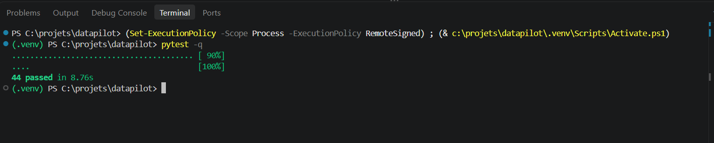
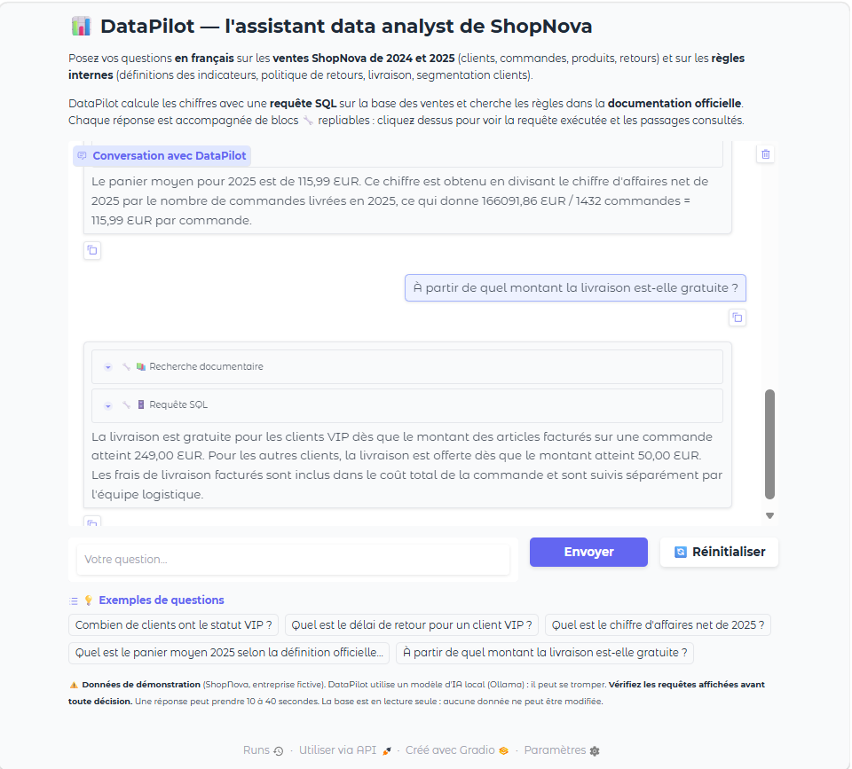
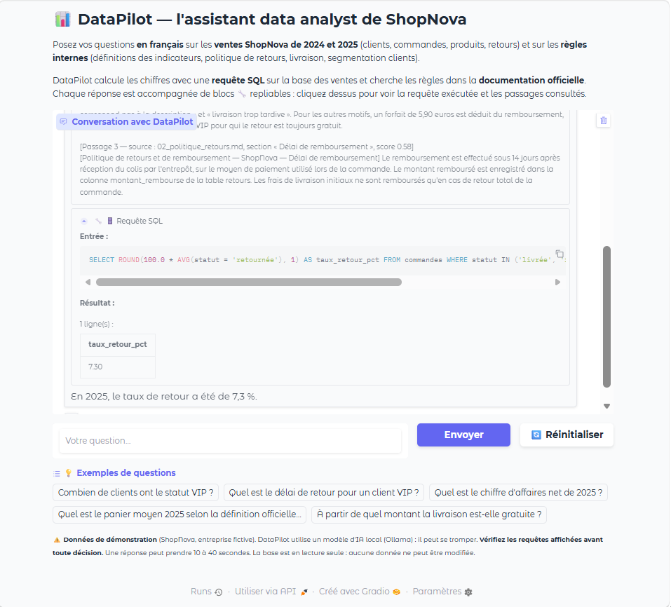

# Carnet de bord — DataPilot

**Binôme :** Nosaiba Elkrekshi 
**Module :** Concevoir un chatbot / agent Data — Nexa Digital School, M2 Data & IA
**Modèle utilisé :** qwen2.5:3b (Ollama, en local)

---

## Étape 0 — Préparer le poste et le projet

### Ce que j'ai fait
- Projet placé dans `C:\projets\datapilot` (chemin court, sans espaces ni accents).
- Installation de **Python 3.12** et création d'un environnement virtuel `.venv`.
- Installation des bibliothèques du projet avec `requirements.txt`.
- Installation d'**Ollama** et du modèle **qwen2.5:3b**.

### À retenir
- **Environnement virtuel (.venv)** : isole les bibliothèques du projet.
- **Ollama** : fait tourner le LLM sur mon ordinateur (`http://localhost:11434`).
- **qwen2.5:3b** : modèle léger (1,9 Go), plus rapide que le 7b.

### Commandes
```powershell
py -3.12 -m venv .venv
.\.venv\Scripts\Activate.ps1
pip install -r requirements.txt
ollama pull qwen2.5:3b
ollama run qwen2.5:3b "Bonjour, réponds en une phrase."
```

### Résultat
- `Python 3.12.10`
- `OK` : les bibliothèques fonctionnent.
- « La base existe déjà » : la base de données est présente.
- `qwen2.5:3b` apparaît dans la liste des modèles d'Ollama.

### Problèmes rencontrés
- Les bibliothèques s'étaient installées dans le mauvais Python (3.14). → Installation de Python 3.12 et activation du venv.
- La commande `ollama` n'était pas reconnue dans VS Code. → Redémarrage de VS Code.
- Le modèle a répondu en portugais (« Olá »). → À corriger plus tard avec le system prompt.

### Questions de réflexion
1. **LLM local :** l'avantage, c'est que les données restent sur ma machine (confidentialité). L'inconvénient, c'est que le modèle est moins puissant qu'un modèle en ligne.
2. **Premier lancement plus lent :** le modèle doit d'abord être chargé en mémoire.
3. **Environnement virtuel :** il évite les conflits de versions entre projets. Sans lui, deux versions de Gradio s'écraseraient.
4. **Chiffre d'affaires :** seules les commandes « livrée » comptent. Cette règle n'est pas dans la base, car c'est une règle métier, écrite dans la documentation.


## Étape 1 — Configuration (config.py)

### Ce que j'ai fait
- Création du fichier `config.py` à la racine du projet.
- Il regroupe tous les réglages du projet : modèle LLM, chemins des données, paramètres du RAG et de l'agent.
- Les autres fichiers l'utiliseront avec `import config`.
- Modèle choisi par défaut : `qwen2.5:3b` (plus léger que le 7b).

### À retenir
- `BASE_DIR` = le dossier du projet, calculé à partir de l'emplacement de config.py.
- `os.getenv("NOM", "défaut")` = lit une variable d'environnement, sinon prend la valeur par défaut.
- `int()` / `float()` = transforment le texte lu en nombre.

### Commandes
```powershell
python -c "import config; print(config.LLM_MODEL, config.DB_PATH.exists(), config.DOCS_DIR.exists(), config.TOP_K)"
$env:LLM_MODEL = "qwen2.5:7b"; python -c "import config; print(config.LLM_MODEL)"
Remove-Item Env:LLM_MODEL
```

### Résultat
- `qwen2.5:3b True True 3` : la config est bien lue, et la base et les documents sont trouvés.
- `qwen2.5:7b` : la variable d'environnement remplace bien la valeur par défaut.

### Questions de réflexion
1. **Pourquoi `__file__` ?** Pour que les chemins restent justes, même si on lance un script depuis un autre dossier.
2. **Pourquoi `float()` / `int()` ?** Parce que `os.getenv` renvoie toujours du texte, pas des nombres.
3. **Pourquoi une température de 0,1 ?** Pour avoir des réponses précises et toujours identiques, ce qui est important pour le SQL. Une température plus élevée sert pour la créativité (idées, textes marketing).
4. **Réglages modifiés souvent :** le modèle, la température, la taille des morceaux, TOP_K. **Presque jamais :** les chemins des fichiers et le modèle d'embeddings.


## Étape 2 — Premier dialogue avec le LLM

### Ce que j'ai fait
- Création du script `explorer/premier_appel.py`.
- Envoi d'une question à Ollama en HTTP (POST sur `/api/chat`) avec la bibliothèque `requests`.
- Lecture de la réponse : le texte, les tokens lus, les tokens générés et la durée.
- 3 expériences : message system, mode JSON, Ollama arrêté.

### À retenir
- Une conversation = une liste de messages avec un rôle : `system` (consignes), `user` (humain), `assistant` (modèle).
- Un **token** ≈ un morceau de mot (environ 4 caractères).
- `prompt_eval_count` = tokens lus ; `eval_count` = tokens générés.

### Commandes
```powershell
python explorer/premier_appel.py      # appel de base
python explorer/premier_appel.py 1    # avec message system
python explorer/premier_appel.py 2    # mode JSON
Get-Process ollama* | Stop-Process -Force   # arrêter Ollama (expérience 3)
Start-Process ollama -ArgumentList "serve" -WindowStyle Hidden   # relancer Ollama
```

### Résultats
| Test | Résultat |
|---|---|
| 1er appel | 200, 42 tokens lus, 47 générés, **8,87 s** |
| 2e appel | 200, **4,16 s** → 2 fois plus rapide (modèle déjà en mémoire) |
| Exp. 1 : system « réponds en anglais » | Réponse en anglais ✅, **34 tokens lus** |
| Exp. 2 : mode JSON | JSON valide ✅, mais 1 seul pays au lieu de 3 |
| Exp. 3 : Ollama arrêté | Erreur `ConnectionError` (WinError 10061) |

### Observations
- Le modèle donne une **définition fausse** du panier moyen (« panier de la ménagère »).
  Il ne connaît pas les règles de ShopNova → il faudra la recherche documentaire (RAG).
- Les réponses changent un peu à chaque appel, même avec une température de 0,1.

### Problèmes rencontrés
- Les expériences ne changeaient pas → le fichier n'était pas enregistré. Solution : `Ctrl + S`,
  et choix de l'expérience directement dans le terminal (`python explorer/premier_appel.py 1`).
- Chaque résultat s'affichait 2 fois → le code avait été collé deux fois dans le fichier.
- `ollama serve` → erreur « adresse de socket » : Ollama tournait déjà sur le port 11434.

### Questions de réflexion
1. **« Je m'appelle Lina » puis « Comment je m'appelle ? » :** le modèle ne s'en souvient pas.
   Un LLM n'a **pas de mémoire** : chaque appel est indépendant. Pour qu'il se souvienne,
   il faut lui renvoyer tout l'historique de la conversation à chaque appel (étape 4).
2. **Effet de `"format": "json"` :** le modèle répond en JSON valide. C'est utile car un
   programme peut lire la réponse directement avec `json.loads()`, sans risque d'erreur de format.
   Attention : le format est garanti, mais pas le contenu (1 pays au lieu de 3).
3. **Tokens et message system :** le system fait partie du texte envoyé, donc le modèle doit
   aussi le lire. Un system prompt de 1 000 tokens envoyé à chaque question rend chaque appel
   plus lent et utilise une partie de la fenêtre de contexte.
   *(Remarque : dans mon test, les tokens ont baissé (34 contre 42), car sans system, Qwen ajoute
   son propre message par défaut, plus long que le mien.)*
4. **Exception levée :** `requests.exceptions.ConnectionError`. Pour un utilisateur non
   technicien, un message clair serait mieux, par exemple :
   « Le moteur IA n'est pas démarré. Lancez Ollama puis réessayez. »


## Étape 3 — Un client LLM robuste (llm_client.py, partie 1)

### Ce que j'ai fait
- Création de `llm_client.py` avec :
  - `LLMError` : notre propre erreur, avec un message clair.
  - `LLMClient.chat()` : envoie la conversation à Ollama et renvoie la réponse.
  - Des **réessais automatiques** sur les erreurs temporaires.
  - Un **journal** : une ligne JSON par échange dans `logs/llm_exchanges.jsonl`.
  - `is_available()` : vérifie si Ollama répond.

### À retenir
- **Erreur temporaire** (Ollama arrêté, timeout, codes 408/429/500/502/503/504) → on réessaie.
- **Erreur définitive** (404, 400) → on s'arrête tout de suite.
- **Backoff exponentiel** : la pause double à chaque essai (1 s, puis 2 s…).
- **JSONL** : un objet JSON par ligne, ce qui est pratique pour un journal.

### Commandes
```powershell
pytest tests/test_etape03_client.py -v
python -c "from llm_client import LLMClient; import config; c = LLMClient(config.LLM_MODEL, config.OLLAMA_URL, log_file='logs/llm_exchanges.jsonl'); print(c.is_available(), c.chat([{'role': 'user', 'content': 'Réponds juste OK.'}]))"
Get-Content logs\llm_exchanges.jsonl -Encoding UTF8
```

### Résultat
- **4 tests passés** : réponse OK, réessai sur erreur temporaire, pas de réessai sur 404, serveur injoignable.
- Avec le vrai Ollama : `True OK`.
- Le journal contient une ligne par appel (date, modèle, durée, tokens, question, réponse).

### Problèmes rencontrés
- Accents mal affichés dans le journal (« Réponds ») → ce n'est qu'un problème d'affichage
  de PowerShell. Solution : `Get-Content ... -Encoding UTF8`.

### Questions de réflexion
1. **Pourquoi ne pas réessayer une 404 ?** Parce que l'erreur ne disparaîtra pas toute seule :
   réessayer ne fait que perdre du temps. Exemple : un nom de modèle mal écrit dans config.py
   (`qwen2.5:3B` au lieu de `qwen2.5:3b`) ou un modèle pas téléchargé.
2. **Temps de pause maximum :** avec 3 essais et backoff = 1 → 1 s + 2 s = **3 secondes** de pause
   (pas de pause après le dernier essai). Pour le pire cas total, il faut **ajouter le timeout de
   chaque essai** : 3 × 120 s + 3 s = 363 s.
3. **Pourquoi « ollama serve » dans le message ?** Parce que l'utilisateur sait ainsi
   **quoi faire** pour régler le problème. Une erreur technique seule (`ConnectionError...`)
   est incompréhensible pour un non-technicien.
4. **Pourquoi JSONL ?** On ajoute simplement une ligne à la fin, sans relire ni réécrire tout
   le fichier. Si le programme plante, les lignes déjà écrites restent valides. Avec un seul gros
   JSON, il faudrait tout recharger à chaque ajout, et un plantage pourrait corrompre le fichier.
5. **Précautions en production :** les questions peuvent contenir des données personnelles.
   Il faudrait anonymiser ou masquer les données sensibles, limiter la durée de conservation
   (par exemple 30 jours, puis suppression), restreindre l'accès aux journaux, et respecter le RGPD.


## Étape 4 — La mémoire conversationnelle (llm_client.py, partie 2)

### Ce que j'ai fait
- Ajout de la classe `Conversation` à la fin de `llm_client.py`.
- Elle garde le **system prompt** et les **derniers échanges** (fenêtre glissante).
- À chaque question, on renvoie tout l'historique au LLM avec `conv.messages()`.
- Script de test `explorer/test_memoire.py` (le test « Lina »).

### À retenir
- Un LLM est **sans mémoire** : c'est le programme qui lui renvoie la conversation.
- **1 tour = 1 question + 1 réponse** = 2 messages.
- On garde le system + les `2 × max_turns` derniers messages.
- Le **system prompt reste toujours en premier**.

### Commandes
```powershell
pytest tests/test_etape04_memoire.py -v
python explorer/test_memoire.py
```

### Résultat
- Test officiel : **1 passed** (avec max_turns=2 et 5 tours → system + Q3, R3, Q4, R4).
- Test « Lina » :
  - SANS mémoire → « Je m'appelle Qwen… » : le modèle ne sait pas.
  - AVEC mémoire → « Vous vous appelez Lina. » ✅

### Problèmes rencontrés
- 1er essai avec mémoire : le modèle 3B n'a pas utilisé l'information, alors que l'historique
  était bien envoyé (31 tokens estimés).
  → Solution : un system prompt plus précis (« Utilise les informations que l'utilisateur
  t'a données plus tôt »). 
  Conclusion : avec un petit modèle, **les consignes comptent beaucoup**.

### Questions de réflexion
1. **Pourquoi `max_turns × 2` ?** Parce qu'un tour = 2 messages (question + réponse).
   Si la fenêtre commençait par une réponse sans sa question, le modèle lirait une réponse
   « orpheline », hors contexte, et pourrait mal comprendre la conversation.
2. **Pourquoi le system prompt ne sort jamais de la fenêtre ?** Il contient les consignes
   (rôle, outils, format JSON, langue). S'il disparaissait, l'agent oublierait comment
   se comporter après quelques questions.
3. **Trois stratégies :**
   - *Fenêtre glissante* : simple, mais oublie les vieux échanges.
   - *Budget de tokens* : garde autant de messages que possible sans dépasser une limite.
   - *Résumé des anciens échanges* : garde l'essentiel de toute la conversation.
   → Pour un **rapport de 30 pages**, je choisirais le **résumé**, car il faut se souvenir
   du plan et des décisions prises depuis le début, sans dépasser la fenêtre de contexte.
4. **Quand l'estimation « caractères / 4 » se trompe ?** Avec du code, du SQL, des chiffres,
   des symboles ou des langues non latines (arabe, chinois) : un caractère peut alors
   correspondre à un token entier, voire plus.


## Étape 5 — Le system prompt (prompts.py)

### Ce que j'ai fait
- Création de `prompts.py` avec `SYSTEM_PROMPT_TEMPLATE` et `build_system_prompt(schema)`.
- Le prompt est organisé en 6 blocs : **Rôle, Outils, Format JSON, Contraintes, Schéma, Exemples**.
- Le schéma de la base est inséré automatiquement à la place de `{schema}`.
- Exploration de la base pour trouver les pièges à signaler au modèle.
- Script de test `explorer/test_prompt.py`.

### À retenir
- Le system prompt, c'est de la « programmation en français » : il définit le comportement de l'agent.
- L'agent répond toujours en JSON : `{"thought": ..., "action": ..., "input": ...}`.
- 3 actions : `query_database` (chiffres), `search_docs` (définitions/règles), `final_answer` (réponse).
- Avec `.format()`, les accolades des exemples JSON doivent être doublées : `{{ }}`.

### Pièges de la base ajoutés dans les rappels
- Statuts avec accents : `'livrée'`, `'annulée'`, `'retournée'`.
- Dates en texte `AAAA-MM-JJ` → filtrer avec `strftime('%Y', date_commande)`.
- Pas de colonne montant dans `commandes` → calcul `quantite * prix_unitaire * (1 - remise_pct/100)`.
- Deux `prix_unitaire` : prix facturé (`lignes_commande`) et prix catalogue (`produits`).
- Les frais de livraison ne comptent pas dans le CA.

### Commande
```powershell
python explorer/test_prompt.py
```

### Résultat (3/3)
| Question | Action obtenue |
|---|---|
| Combien de commandes livrées en 2025 ? | `query_database` ✅ (SQL correct, avec accent et strftime) |
| Politique de retour VIP ? | `search_docs` ✅ |
| Bonjour, qui es-tu ? | `final_answer` ✅ |

Taille du prompt : 5 882 caractères ≈ **1 470 tokens** (envoyés à chaque question).

### Questions de réflexion
1. **Pourquoi du JSON ?** Parce que Python peut le lire directement (`json.loads`) et savoir
   quelle action exécuter. Une phrase comme « Je pense qu'il faudrait regarder dans la base »
   est inutilisable : le programme ne sait pas quoi faire. Il faut la rejeter et redemander au
   modèle de répondre au bon format (c'est ce que fait `route_query` à l'étape 9).
2. **À quoi sert `thought` ?** Pour le modèle : il réfléchit avant d'agir, ce qui l'aide à choisir
   la bonne action. Pour moi : je comprends pourquoi il a fait ce choix, ce qui aide à déboguer.
3. **Pourquoi insérer le schéma automatiquement ?** Si la base change (nouvelle colonne, nouvelle
   table), le prompt est mis à jour tout seul. Le recopier à la main risque des oublis et des erreurs.
4. **Pièges mis dans les rappels, et l'erreur sans eux :**
   - accents → `statut = 'livree'` et 0 résultat ;
   - dates en texte → `YEAR(date_commande)`, qui n'existe pas en SQLite ;
   - pas de colonne montant → une colonne `montant` inventée, donc une erreur SQL ;
   - deux prix → le prix catalogue au lieu du prix facturé, donc un CA faux.
5. **La question exacte dans les exemples :** le modèle recopierait la réponse au lieu de raisonner.
   Il réussirait l'évaluation sur cette question « par cœur », ce qui donnerait une fausse impression
   de qualité. Mes exemples utilisent donc d'autres questions.
6. **Le system prompt est-il une garantie ?** Non : le modèle peut ne pas le respecter (JSON mal formé,
   SQL dangereux, mauvaise action). Le code doit donc vérifier : lire le JSON avec tolérance, bloquer
   tout SQL qui n'est pas un SELECT, ouvrir la base en lecture seule, limiter le nombre d'étapes.


## Étape 6 — L'outil SQL sécurisé (tools.py, partie 1)

### Ce que j'ai fait
- Création de `tools.py` avec :
  - `validate_sql()` : nettoie et vérifie la requête avant exécution.
  - `format_results()` : présente le résultat en tableau markdown.
  - `SQLTool` : exécute la requête en lecture seule et renvoie toujours du texte.
- Expérience sur l'injection SQL (`explorer/injection.py`).
- Test manuel de l'outil (`explorer/test_sql.py`).

### À retenir : les 4 barrières de sécurité
| Barrière | Technique | Protège contre |
|---|---|---|
| 1. Lecture seule | `mode=ro` + `PRAGMA query_only = ON` | toute écriture |
| 2. Validation | un seul ordre, SELECT/WITH, pas de mot interdit | requêtes dangereuses |
| 3. Paramètres | valeurs passées par `?` | injection SQL |
| 4. Limite de lignes | `fetchmany(max_rows + 1)` | saturer la mémoire et le LLM |

- Une erreur SQL est renvoyée **en texte** (« ERREUR SQL : ... ») → le LLM peut la lire
  et corriger sa requête : c'est **l'auto-correction**.

### Commandes
```powershell
python explorer/injection.py
pytest tests/test_etape06_sql.py -v
python explorer/test_sql.py
```

### Résultats
- **Injection SQL** avec la saisie `VIP' OR '1'='1` :
  - avec f-string → **500** (tous les clients !) ⚠️
  - avec paramètre `?` → **0**
- **Tests : 18 passed.**
- **Test manuel :**
  - `SELECT segment, COUNT(*)...` → tableau de 3 lignes (Premium 90, Standard 371, VIP 39)
  - `DELETE FROM clients` → « ERREUR : requête refusée »
  - `SELECT montant FROM commandes` → « ERREUR SQL : no such column: montant »

### Questions de réflexion
1. **Si je ne gardais qu'une barrière :** la **lecture seule** (barrière 1), car elle bloque
   toute écriture au niveau de SQLite, même si la validation est contournée. Les autres
   restent utiles : la validation donne un message clair au LLM, les paramètres
   empêchent l'injection, et la limite de lignes protège la mémoire. C'est la **défense en profondeur**.
2. **Pourquoi la f-string renvoie 500 clients ?** La saisie est collée dans le texte SQL, ce
   qui donne `WHERE segment = 'VIP' OR '1'='1'`. Comme `'1'='1'` est toujours vrai, la
   condition est vraie pour tous les clients. Avec `?`, la saisie est traitée comme une simple
   valeur : aucun segment ne s'appelle `VIP' OR '1'='1`, donc 0.
3. **Pourquoi `run` ne lève jamais d'exception ?** Pour ne pas faire planter l'agent. C'est le
   **LLM** qui lit le message d'erreur : il comprend son erreur (ex. « no such column: montant »)
   et corrige sa requête au tour suivant.
4. **Requête légitime refusée par les mots interdits :** une colonne `date_update` ou
   `created_at` ne pose pas problème grâce à `\b`, mais une valeur texte, si :
   `SELECT * FROM produits WHERE nom = 'Kit DROP'`, ou un motif de retour qui contient
   `'delete'`, serait refusé à tort.
5. **Pourquoi un tableau markdown ?** Le LLM lit du texte : un tableau avec les noms de
   colonnes, le nombre de lignes et des décimales arrondies est clair et compact.
   Une liste de tuples Python (`[('Premium', 90), ...]`) n'indique pas les noms de colonnes,
   et le LLM risque de mal l'interpréter.
6. **Protection supplémentaire sur PostgreSQL :** un **utilisateur dédié en lecture seule**
   (droit `SELECT` uniquement, sur les seules tables utiles), une **vue sans la colonne email**
   pour protéger les données personnelles, et un **délai maximal par requête**
   (`statement_timeout`) pour couper une requête trop lourde. La sécurité est alors garantie
   par le serveur lui-même, pas seulement par mon code.


## Étape 7 — Découper la documentation (tools.py, partie 2)

### Ce que j'ai fait
- Ajout dans `tools.py` de :
  - `Chunk` : un morceau (texte, fichier source, section).
  - `chunk_text()` : découpe un texte en morceaux de 500 caractères max, sans couper les mots,
    avec un chevauchement de 100 caractères.
  - `chunk_markdown()` : découpe un document par section `##`, puis ajoute le préfixe `[Titre — Section]`.
  - `load_corpus()` : lit tous les fichiers `.md` (en UTF-8) et renvoie tous les morceaux.
- Script de test `explorer/test_chunks.py`.

### À retenir
- **RAG** = chercher les bons passages dans la documentation, puis les donner au LLM.
  - Indexation (une fois) : documents → morceaux → vecteurs → index.
  - Interrogation (à chaque question) : question → vecteur → morceaux proches → LLM.
- On découpe d'abord par **titres de section**, puis par **taille**.
- Le **préfixe** `[Titre — Section]` rend chaque morceau compréhensible tout seul.
- Le **chevauchement** évite de perdre une idée coupée en deux.

### Commandes
```powershell
pytest tests/test_etape07_chunking.py -v
python explorer/test_chunks.py
```

### Résultats
- **Tests : 3 passed.**
- **36 morceaux** avec chunk_size=500 et overlap=100 (= valeur de référence du guide).
- Comparaison des tailles :

| chunk_size | Nombre de morceaux |
|---|---|
| 200 | 70 |
| 500 | 36 |
| 1000 | 35 |

### Questions de réflexion
1. **Tailles 200 / 500 / 1000 :** 70, 36 et 35 morceaux. Entre 500 et 1000, presque aucune
   différence, car les sections `##` sont déjà courtes : c'est le découpage par titres qui décide.
   À 200, les morceaux restent compréhensibles grâce au préfixe, mais certaines phrases sont
   coupées (« …Le taux » à la fin d'un morceau). Le chevauchement permet de les retrouver
   dans le morceau suivant.
2. **Pourquoi le préfixe `[Titre — Section]` ?** Il donne le contexte au morceau. Exemple :
   un morceau qui dit « Ce délai est porté à 60 jours » ne précise pas de quoi il parle. Avec
   `[Politique de retours — Délai de rétractation]`, on sait que c'est le délai de retour : la
   recherche le retrouve donc pour une question sur les retours VIP.
3. **Sans chevauchement :** une règle coupée en deux serait répartie dans deux morceaux incomplets.
   Aucun des deux ne contiendrait la règle entière : la recherche risquerait de ne pas la trouver,
   ou le LLM recevrait une information partielle et répondrait mal.
4. **Pourquoi `encoding="utf-8"` sous Windows ?** Windows lit par défaut avec un autre encodage
   (cp1252) : les accents et symboles (é, à, —, «) seraient mal lus (« é ») ou provoqueraient une
   erreur. J'ai vu le même problème d'affichage avec le journal JSONL à l'étape 3.
5. **Découper un PDF de 80 pages sans titres :** extraire le texte, découper par paragraphes ou par
   pages, puis par taille fixe avec chevauchement, en gardant le numéro de page comme source.
   On peut aussi repérer des titres « cachés » (lignes courtes, en majuscules ou en gras).


## Étape 8 — Embeddings, FAISS et recherche documentaire (tools.py, partie 3)

### Ce que j'ai fait
- Ajout dans `tools.py` de :
  - `DocSearchTool` : transforme les morceaux en vecteurs, les range dans un index FAISS,
    et retrouve les passages les plus proches d'une question.
  - `load_embedder()` : charge le modèle `paraphrase-multilingual-MiniLM-L12-v2`.
- Scripts : `explorer/embeddings.py`, `explorer/hit_rate.py`, `explorer/test_docs.py`.

### À retenir
- **Embedding** = 384 nombres qui représentent le *sens* d'un texte.
- **Similarité cosinus** : 1 = même sens, 0 = aucun rapport.
- **FAISS `IndexFlatIP`** : compare par produit scalaire = cosinus si les vecteurs sont normalisés.
- FAISS ne stocke pas les textes : on garde la liste des morceaux dans le même ordre.
- **Hit rate @k** = % de questions où le bon document est dans les k premiers résultats.

### Commandes
```powershell
python explorer/embeddings.py
pytest tests/test_etape08_recherche.py -v
python explorer/hit_rate.py
python explorer/test_docs.py
python explorer/hit_rate.py 300 500 800
```

### Résultats
- **Expérience embeddings :** vecteurs de forme (3, 384). Matrice de similarité :
  ```
  [[1.   0.57 0.22]
   [0.57 1.   0.16]
   [0.22 0.16 1.  ]]
  ```
  La phrase la plus proche de la question « Combien de temps ai-je pour renvoyer un article ? »
  est « Le client dispose de 30 jours pour retourner un article. » (**0,57**), contre 0,22 pour
  la phrase sur la livraison. Le modèle comprend le **sens** même sans mots identiques
  (« renvoyer » ≈ « retourner »).
- **Tests : 2 passed.**
- **Hit rate (chunk_size 500) : @1 = 100 %, @3 = 100 %** (8/8 questions).
- **« Quel est le délai de retour pour un client VIP ? »** :
  1. `02_politique_retours.md` — Délai de rétractation (score 0,79) ✅
  2. `03_segmentation_clients.md` — Segment VIP (score 0,74)
  3. `02_politique_retours.md` — Délai de remboursement (score 0,61)
- **Comparaison des tailles :**

| chunk_size | Morceaux | Hit rate @1 | Hit rate @3 |
|---|---|---|---|
| 300 | 48 | 100 % | 100 % |
| 500 | 36 | 100 % | 100 % |
| 800 | 35 | 100 % | 100 % |

### Questions de réflexion
1. **Même modèle pour la question et les documents :** chaque modèle a sa propre « carte » du
   sens. Des vecteurs issus de deux modèles différents ne sont pas comparables : la distance
   entre eux ne voudrait rien dire.
2. **Pourquoi normaliser ?** Avec des vecteurs de longueur 1, le produit scalaire = le cosinus,
   donc on mesure seulement le **sens** (la direction). Sinon, l'index mesurerait aussi la
   **longueur** des vecteurs : certains textes auraient un score plus élevé sans être plus pertinents.
3. **La recherche renvoie toujours k passages** (même pour « salaire moyen des employés ») :
   risque que l'agent utilise des passages hors sujet et **invente une réponse**.
   Parades : (a) un **seuil de score minimum** (ex. < 0,4 → « Aucun passage pertinent ») ;
   (b) une consigne dans le system prompt : « si les passages ne répondent pas à la question,
   dis que l'information n'est pas disponible ».
4. **Comparaison 300 / 500 / 800 :** même résultat (100 %). Les documents sont courts et
   bien structurés par sections `##`, donc la taille change peu de chose. Mais **8 questions ne
   suffisent pas** pour conclure solidement : les questions sont faciles et proches des titres.
   Il faudrait un jeu plus grand (50 à 100 questions), avec des reformulations, des questions
   difficiles et des questions hors sujet.
5. **RAG plutôt que fine-tuning, et plutôt que tout coller dans le prompt :**
   - Fine-tuning : il faudrait réentraîner le modèle à chaque changement de la politique de retours
     (coûteux, lent), et on ne saurait pas d'où vient la réponse. Avec le RAG, on modifie juste le
     document, et la source est citée.
   - Tout coller dans le prompt : le prompt deviendrait énorme (plus lent, plus de tokens à chaque
     question, fenêtre de contexte vite saturée), et le petit modèle se perdrait dans trop de texte.
     Le RAG n'envoie que les 3 passages utiles.
6. **Une solution qui stocke aussi les textes et les métadonnées :** une base vectorielle comme
   **ChromaDB**, **Qdrant** ou **pgvector** (dans PostgreSQL). Je la préférerais avec beaucoup de
   documents, des mises à jour fréquentes, des filtres sur les métadonnées (date, service, type de
   document) ou plusieurs utilisateurs. Pour 36 morceaux, FAISS en mémoire suffit.


## Étape 9 — Lire la décision du LLM et router (agent.py, partie 1)

### Ce que j'ai fait
- Création de `agent.py` avec :
  - `Decision` : la décision du LLM (action, input, thought, params).
  - `ParseError` : erreur quand le JSON est introuvable ou incomplet.
  - `parse_llm_output()` : lit le JSON du LLM, même entouré de texte ou de balises markdown.
  - `RouteResult` : le résultat du routage (`tool`, `final` ou `error`).
  - `route_query()` : choisit l'outil, l'exécute et renvoie le résultat.
- Script de test `explorer/test_routing.py`.

### À retenir
- **Le LLM propose, Python exécute** : le modèle n'a jamais accès directement à la base.
- **Lecture tolérante** : texte autour du JSON, balises ```json, clé `action_input` → acceptés.
- **Une erreur = un message pour le LLM** : pas d'exception, le LLM lit l'erreur et se corrige.

| Cas | Résultat |
|---|---|
| JSON illisible | `error` → « Réponds UNIQUEMENT avec un objet JSON » |
| `final_answer` | `final` → la réponse |
| Outil inconnu | `error` → « Outil inconnu… Outils valides : … » |
| Outil connu | `tool` → résultat de l'outil |

### Commandes
```powershell
pytest tests/test_etape09_routing.py -v
python explorer/test_routing.py
```

### Résultats
- **Tests : 8 passed.**
- Outil connu → `RouteResult(kind='tool', ...)` avec **30** produits.
- Outil inconnu → « Outil inconnu « envoyer_email ». Outils valides : query_database, final_answer. »
- Regex gourmande vs non gourmande sur `{"action": "x", "input": {"a": 1}}` :
  - `.*`  → `{"action": "x", "input": {"a": 1}}` ✅ JSON complet
  - `.*?` → `{"action": "x", "input": {"a": 1}` ❌ JSON coupé (il manque la dernière `}`)

### Questions de réflexion
1. **Pourquoi `.*` (gourmande) ?** Elle va jusqu'à la **dernière** `}`, ce qui récupère tout le JSON,
   même avec un objet imbriqué. La version `.*?` s'arrête à la **première** `}` : le JSON est coupé
   et devient invalide (vérifié dans mon test).
2. **Pourquoi un RouteResult d'erreur plutôt qu'une exception ?** Pour que l'agent ne plante pas.
   Le message d'erreur est renvoyé au LLM, qui voit son erreur (par exemple la liste des outils valides)
   et peut se corriger au tour suivant.
3. **Ajouter un 3e outil :** créer une classe avec une méthode `run()` dans `tools.py`, l'ajouter au
   dictionnaire `tools` dans `build_agent()`, et la décrire dans `prompts.py` (son nom, quand
   l'utiliser, ce que contient `input`). `route_query` ne change pas.
4. **Avantage pour les tests :** on peut utiliser un **faux outil** (comme `EchoTool`) au lieu de la vraie
   base ou du vrai modèle. Les tests sont rapides, toujours identiques, et ne demandent pas Ollama.
5. **Tool calling natif :** il apporterait un format garanti par l'API (moins de JSON mal formé), la
   vérification des paramètres et plusieurs outils en parallèle. Notre version « manuelle » m'a fait
   comprendre que **le LLM ne fait qu'écrire du texte** : c'est le programme qui lit, vérifie et exécute.


## Étape 10 — La boucle de l'agent (agent.py, partie 2)

### Ce que j'ai fait
- Ajout dans `agent.py` de :
  - `AgentResponse` : la réponse finale + la liste des étapes (trace).
  - `Agent.ask()` : la boucle ReAct (le LLM décide → l'outil s'exécute → OBSERVATION → …).
  - `build_agent()` : assemble le LLM, les 2 outils, le system prompt et l'agent.
  - Un **mode console** : `python agent.py`.
- 3 séries de tests sur les 6 questions de référence, avec 2 améliorations du prompt.

### À retenir
- **Boucle ReAct** (Reason + Act) : une question peut demander plusieurs outils à la suite.
- **Deux mémoires :**
  - *Mémoire longue* : questions + réponses finales (gardée d'une question à l'autre).
  - *Brouillon* : décisions + observations d'une seule question (jeté ensuite).
- **Garde-fous** : 5 étapes max, réponse forcée, message clair si Ollama est en panne.

### Commandes
```powershell
pytest tests/test_etape10_agent.py -v
python agent.py
```

### Résultats
- **Tests : 5 passed** (avec un faux LLM).
- **Évolution sur les 6 questions (modèle qwen2.5:3b) :**

| # | Question | Référence | Essai 1 (prompt initial) | Essai 2 (+ recettes SQL) | Essai 3 (+ règle 2) |
|---|---|---|---|---|---|
| 1 | Clients VIP | 39 | 39 ✅ | 39 ✅ | 39 ✅ |
| 2 | CA net 2025 | 166 091,86 € | 206 265,70 € ❌ | 166 091,86 € ✅ | 166 091,86 € ✅ |
| 3 | Délai retour VIP | 60 jours | 60 j ⚠️ (invente « justifier ») | « pas d'info » ❌ | 60 jours ✅ |
| 4 | Panier moyen 2025 | 115,99 € | 51,35 € ❌ | 115,99 € ✅ | 115,98 € ⚠️ |
| 5 | Clients actifs | 445 | 101 ❌ | 445 ✅ | 39 ❌ |
| 6 | Dont VIP ? | 39 | 10 ❌ | 445 ❌ | 12 ❌ |
| | **Score** | | **1/6** | **4/6** | **3/6 + 1 presque** |

Outils utilisés (essai 3) :

| # | Question | Outils, dans l'ordre |
|---|---|---|
| 1 | Clients VIP | search_docs → query_database |
| 2 | CA net 2025 | query_database |
| 3 | Délai retour VIP | search_docs |
| 4 | Panier moyen 2025 | search_docs → query_database |
| 5 | Clients actifs | search_docs → query_database → query_database |
| 6 | Dont VIP ? | search_docs × 5 (aucune requête SQL), puis réponse forcée |

Les requêtes SQL fautives sont détaillées dans « Améliorations apportées au prompt » ci-dessous
et dans l'analyse de l'étape 11.

### Améliorations apportées au prompt
1. **Recettes SQL** pour le CA net, le panier moyen et les clients actifs (formules du glossaire
   officiel traduites en SQL) → corrige les erreurs de calcul (oubli de `quantite`, de `statut = 'livrée'`,
   `AVG(prix_unitaire)` au lieu de CA ÷ commandes, `date_inscription` au lieu des commandes livrées).
2. **« La réponse finale ne contient QUE les informations des OBSERVATIONS »** → pour éviter les
   inventions (ex. « les VIP doivent justifier leur retour », alors que le document dit l'inverse).
3. **RÈGLE 2** : « toujours utiliser search_docs pour une règle ou un délai » + un 3e exemple
   → corrige la régression de l'essai 2 (« je n'ai pas d'information » sans chercher).

> Remarque : les recettes SQL donnent des formules générales, pas les réponses. Elles améliorent
> l'agent sur ces indicateurs, mais rendent le résultat dépendant du prompt.

### Erreurs observées et explications
- **Le modèle n'est pas déterministe** : la même question suit des chemins différents d'un essai à l'autre.
- **Régression** : une règle ajoutée pour corriger un problème en a créé un autre (essai 2, question 3).
  → D'où l'intérêt d'un banc de test automatique (étape 14).
- **Calcul de tête** (question 4, essai 3) : le LLM a fait la division lui-même et mal arrondi
  (115,98 au lieu de 115,99) → les calculs doivent être faits dans le SQL.
- **Boucles** (question 6) : 5 requêtes presque identiques (essai 2) ou 5 search_docs (essai 3).
  Le garde-fou `MAX_STEPS = 5` a arrêté la boucle et forcé une réponse. ✅
- **Mémoire** : l'agent comprend bien « eux » grâce à la mémoire longue, mais le modèle 3B
  ne parvient pas à combiner la définition + la jointure + le segment.
- **Conclusion** : l'agent **ne plante jamais** ✅ et le routage fonctionne. Les erreurs viennent
  des limites du petit modèle (3B) sur le SQL complexe et les questions en plusieurs étapes.

### Questions de réflexion
1. **Pourquoi limiter le nombre d'étapes ?** Sans limite, si le LLM répète la même requête
   erronée, l'agent tourne indéfiniment : l'utilisateur attend sans fin, et des tokens et du temps sont gaspillés. Observé à la question 6 : la limite a arrêté la boucle après 5 étapes.
2. **Mémoire longue vs brouillon :** la mémoire longue garde seulement les questions et les réponses
   finales (utile pour comprendre « eux »). Le brouillon garde les étapes intermédiaires d'une seule question. Si toutes les observations restaient en mémoire (tableaux SQL de 50 lignes, passages de documentation), la fenêtre de contexte serait vite saturée, et le modèle serait plus lent et plus confus.
3. **Pourquoi l'observation a le rôle `user` ?** Ce n'est pas le modèle qui l'a écrite, donc pas
   `assistant` : sinon il croirait l'avoir inventée. Ce n'est pas une consigne permanente, donc pas
   `system` : c'est une information nouvelle qui vient de l'extérieur, comme un message de l'utilisateur.
4. **Panier moyen : la documentation a-t-elle été consultée ?** Essai 1 : oui, mais le SQL était faux.
   Essai 2 : non, il a appliqué directement la recette. Essai 3 : oui, puis le bon SQL.
   → J'ai ajouté les recettes SQL dans le prompt pour que la définition soit bien traduite en SQL.
5. **Qu'est-ce qui permet de comprendre « eux » ?** La **mémoire longue** (`Conversation`) :
   la question précédente et sa réponse (« 445 clients actifs ») sont renvoyées au LLM.
   Vérification SQL : **39 clients VIP actifs** (tous les VIP sont actifs).
   ```sql
   SELECT COUNT(DISTINCT c.client_id) FROM commandes c
   JOIN clients cl ON cl.client_id = c.client_id
   WHERE cl.segment = 'VIP' AND c.statut = 'livrée'
     AND c.date_commande > date('2025-12-31', '-365 days') AND c.date_commande <= '2025-12-31'
   ```
6. **Ce que prouvent les tests avec un faux LLM :** que la **mécanique** fonctionne (boucle,
   observations, mémoire, réponse forcée, panne du LLM). Ils ne prouvent **pas** que le vrai modèle
   prend les bonnes décisions ni que ses réponses sont justes : pour cela, il faut l'évaluation
   avec le vrai LLM .


## Étape 11 — Faire le point : tests et journaux

### Ce que j'ai fait
- Lancement de **tous les tests** des étapes 3 à 10 d'un seul coup.
- Analyse du journal `logs/llm_exchanges.jsonl` avec pandas (script `explorer/analyse_logs.py`).
- Analyse détaillée d'une erreur de l'agent, appel par appel.

### À retenir
| Niveau | Outil | Vérifie | Ne vérifie pas |
|---|---|---|---|
| Tests unitaires | pytest + doublures (FakeLLM, FakeEmbedder, faux serveur) | la mécanique (routage, réessais, lecture seule, mémoire) | l'intelligence du modèle |
| Évaluation par scénarios | vrai LLM + questions de référence | le comportement réel | la cause d'une erreur → il faut lire les journaux |

- Une **doublure** (fake) remplace un composant lent ou imprévisible par un objet simple qui a la même
  interface. `FakeLLM.chat()` a la même signature que `LLMClient.chat()` : l'agent ne voit pas la différence.

### Commandes
```powershell
pytest tests/test_etape03_client.py tests/test_etape04_memoire.py tests/test_etape06_sql.py tests/test_etape07_chunking.py tests/test_etape08_recherche.py tests/test_etape09_routing.py tests/test_etape10_agent.py -q
python explorer/analyse_logs.py
python explorer/analyse_logs.py "entre eux"
```

### Résultats
- **Tests : 41 passed.**
- **Statistiques du journal (58 appels au LLM, modèle qwen2.5:3b, CPU) :**

| Indicateur | Valeur |
|---|---|
| Durée moyenne d'un appel | **12,05 s** (médiane 10,68 s ; min 4,41 s ; max 33,53 s) |
| Tokens lus en moyenne par appel | **2 518** (min 35 ; max 4 923) |
| Tokens générés en moyenne | **95** |
| Attente estimée pour une question en 3 étapes | **≈ 36 s** |

### Analyse d'une erreur : « Et combien d'entre eux sont VIP ? » (réponse attendue : 39)
Trace de l'essai 2 (appel par appel) :

| Appel | Ce que le LLM a reçu | Décision du LLM | Tokens lus |
|---|---|---|---|
| 1 | la question | SQL avec `JOIN` **après** `WHERE` ❌ | 2 421 |
| 2 | ERREUR SQL : near "JOIN": syntax error | corrige en sous-requête, mais mauvaise colonne | 2 610 |
| 3 | ERREUR SQL : no such column: date_commande | même type de requête | 2 831 |
| 4 | ERREUR SQL : no such column: commandes.date_commande | même requête | 3 083 |
| 5 | même erreur | même requête (**boucle**) | 3 341 |
| 6 | « Tu as atteint le nombre maximal d'étapes » | réponse forcée : **445 VIP** ❌ (chiffre inventé, c'était le nombre total d'actifs) | 3 631 |

- **Étape de l'erreur :** dès l'**appel 1** (syntaxe SQL invalide), puis le modèle n'arrive pas à corriger
  sa sous-requête et **répète la même erreur** (appels 3 à 5).
- L'**auto-correction a fonctionné en partie** : le LLM a bien lu les messages d'ERREUR SQL et changé de
  stratégie (JOIN → sous-requête), mais il n'a pas trouvé la bonne requête.
- Le **garde-fou MAX_STEPS** a arrêté la boucle ✅, mais la réponse forcée est **fausse** : le modèle a
  réutilisé un chiffre de la mémoire (445) au lieu de dire qu'il n'avait pas trouvé.
- Essai 3 : autre type d'erreur : **5 search_docs** de suite (aucune requête SQL), puis un chiffre
  **inventé** (12).
- Essai 1 : il a filtré sur `date_inscription = 2025` (mauvaise définition) → 10.

### Questions de réflexion
1. **Pourquoi un test avec le vrai LLM serait « instable » ?** Le LLM n'est pas déterministe : la même
   question peut donner des réponses différentes d'un lancement à l'autre (constaté à l'étape 10 : 3 essais, 3 chemins différents). Le test passerait une fois, puis échouerait la fois suivante, sans que le code ait changé. Il serait aussi lent (≈ 12 s par appel) et dépendant d'Ollama.

2. **Pourquoi les tokens lus augmentent au fil des étapes ?** À chaque étape, on ajoute au brouillon la
   décision du LLM + l'OBSERVATION (résultat SQL, passages de documentation). Tout est renvoyé au LLM
   à chaque appel. Exemple vu dans le journal : 2 421 → 2 610 → 2 831 → 3 083 → 3 341 → 3 631 tokens.

3. **Durée moyenne et conséquences :** environ **12 s par appel** sur mon poste (CPU). Une question en
   3 étapes ≈ **36 s d'attente**. Pour l'interface, il faut donc : un **indicateur de chargement**,
   l'affichage des **étapes** pour que l'utilisateur voie que l'agent travaille, et des exemples de questions simples. Un modèle plus petit ou un GPU réduiraient l'attente.

4. **Un test vert garantit-il le bon CA ?** **Non.** Les tests utilisent un **faux LLM** dont les réponses
   sont écrites à l'avance : ils prouvent que la mécanique fonctionne (boucle, routage, lecture seule), pas que le vrai modèle écrira la bonne requête SQL. Seule une évaluation avec le vrai LLM et des valeurs de référence peut le vérifier.


## Étape 12 — L'interface web avec Gradio (ui.py)

### Ce que j'ai fait
- Création de `ui.py` avec :
  - `message_text()` : recolle le texte d'un message (piège de Gradio 6 : contenu en liste).
  - `steps_to_messages()` : transforme les étapes de l'agent en **blocs repliables** 🔧 (requête + résultat) ou ⚠️ (erreur).
  - `create_ui()` : construit la page (titre, description, conversation, saisie, boutons, exemples).
- Création de `pytest.ini` (`testpaths = tests`) : sans lui, `pytest -q` exécutait aussi mes scripts
  `explorer/test_*.py`, qui appellent le vrai LLM (erreur ou attente très longue).

### À retenir
- **Gradio** transforme des fonctions Python en application web, sans HTML ni JavaScript.
- **Deux événements enchaînés** : `add_user_message` (instantané : affiche la question) puis
  `.then(bot_response)` (lent : appelle l'agent, avec un indicateur de chargement).
- `"metadata": {"title": "🔧 ..."}` → message affiché en **bloc repliable**.
- `create_ui(agent)` ne connaît que `ask()` et `reset()` : l'interface est indépendante du reste.

### Commandes
```powershell
pytest tests/test_etape12_interface.py -v
python ui.py          # puis ouvrir http://127.0.0.1:7860
pytest -q
```

### Résultats
- **Tests interface : 3 passed** 
 **Suite complète : 44 passed** 🎉
- Interface fonctionnelle : la question s'affiche immédiatement, l'indicateur tourne, puis les blocs
  🔧 Recherche documentaire / 🔧 Requête SQL et la réponse ; « Réinitialiser » vide tout.
- Questions posées dans l'interface :

| Question | Outils | Réponse | Verdict |
|---|---|---|---|
| CA net 2025 | doc → SQL | 166 091,86 € | ✅ (lit la définition puis applique la recette) |
| Définition du taux de retour | doc | part des commandes expédiées qui reviennent, alerte à 8 % | ⚠️ formule déformée + ajout inventé (« satisfaction client ») |
| Clients VIP | doc → SQL | 39 | ✅ |
| Délai retour VIP | doc | 60 jours | ✅ |
| Panier moyen 2025 | SQL | 115,99 € | ✅ |

### Problèmes rencontrés
- `pytest -q` lançait aussi les scripts `explorer/test_*.py` (appels au vrai LLM) → ajout de `pytest.ini`.

### Questions de réflexion
1. **Pourquoi deux événements enchaînés ?** Avec une seule fonction, la question ne s'afficherait
   qu'à la fin du calcul (≈ 10 à 40 s) : l'utilisateur croirait que rien ne se passe. Avec deux événements, la question apparaît **tout de suite** et un **indicateur de chargement** tourne pendant que l'agent travaille.

2. **Remplacer l'interface ou le LLM :**
   - Autre interface (Streamlit, mobile) → seulement **`ui.py`** (l'agent ne change pas, l'interface
     n'utilise que `ask()` et `reset()`).
   - API en ligne au lieu d'Ollama → seulement **`llm_client.py`** (et les réglages dans `config.py`) :
     tant que la méthode `chat(messages, json_mode)` existe, l'agent ne voit pas la différence.

3. **Pourquoi montrer la requête SQL à un utilisateur métier ?** Pour la **transparence et la
   confiance** : il voit d'où vient le chiffre et quelles sources ont été lues. Un analyste peut
   vérifier la requête, et l'utilisateur peut repérer un filtre oublié (période, statut). Les blocs
   sont repliés : ils ne gênent pas ceux qui ne les lisent pas.

4. **Deux onglets — testé :** dans l'onglet 1, j'ai demandé « Combien de clients actifs au 31 décembre
   2025 ? » (réponse : 445 ✅). Dans l'onglet 2, sans réinitialiser, j'ai demandé « Et combien d'entre eux sont VIP ? ». L'agent a répondu en parlant des « clients VIP actifs au 31 décembre 2025 » : il savait ce que « eux » voulait dire, alors que l'onglet 2 n'avait jamais posé la question.
  
   → **La mémoire est partagée** : il n'y a qu'un seul agent (une seule `Conversation`) pour tout le monde.
   Pire, elle fausse les chiffres : à la question simple « Combien de clients ont le statut VIP ? »,
   l'agent a ajouté un filtre `strftime('%Y', date_inscription) = '2025'` venu du contexte de l'autre onglet, et a répondu **10 au lieu de 39**.
   En production, les conversations de plusieurs utilisateurs se mélangeraient (réponses fausses, et
   **fuite d'informations** d'un utilisateur à l'autre). Il faudrait une mémoire **par session**
   (par exemple `gr.State`, ou un agent par utilisateur).

5. **Ollama arrêté — testé :** l'interface **ne plante pas** : la question s'affiche, puis un message
   arrive après les 3 essais : « Le moteur IA est indisponible pour le moment. Impossible de joindre le LLM après 3 essais (HTTPConnectionPool… WinError 10061…). Vérifiez qu'Ollama est lancé : ollama serve ».
   Le comportement est **acceptable** (pas de plantage, la solution est indiquée), mais le message est **trop technique** pour un utilisateur métier (`HTTPConnectionPool`, `WinError 10061`).
   Il faudrait afficher seulement : « Le moteur IA est indisponible pour le moment. Lancez l'application Ollama, puis réessayez. » et garder le détail technique dans les journaux.

   → **Corrigé dans `agent.py`** : le message affiché est maintenant « Le moteur IA est indisponible
   pour le moment. Lancez l'application Ollama (ou « ollama serve »), puis réessayez. », et le détail
   technique reste dans le terminal grâce à `logger.error`. Les 44 tests passent toujours.


## Étape 13 — Personnaliser l'interface

### Ce que j'ai fait (dans `ui.py`)
| Élément | Modification |
|---|---|
| Titre | 📊 DataPilot — l'assistant data analyst de ShopNova |
| Description | 2 paragraphes : **périmètre** (ventes 2024-2025, règles internes) + **transparence** (blocs 🔧 avec requêtes et sources) |
| Exemples | 5 questions : chiffrée (VIP), règle (délai retour, livraison), **mixtes** (CA net, panier moyen) |
| Message d'accueil | « 👋 Bonjour ! Posez une question… ou cliquez sur un exemple » |
| Pied de page | ⚠️ données de démonstration, le modèle peut se tromper, **vérifier les requêtes**, temps de réponse 10-40 s, base en lecture seule |
| Bouton copier | sur chaque message (`buttons=["copy"]`) |
| Blocs repliables | 🔧 🗄️ Requête SQL / 🔧 📚 Recherche documentaire |

Correction également apportée dans `prompts.py` (bloc CONTRAINTES) :
« Fais TOUJOURS les calculs (divisions, moyennes, pourcentages) DANS la requête SQL, en une seule
requête, jamais de tête. Ne recalcule pas toi-même un résultat donné par une OBSERVATION. »

### Commandes
```powershell
pytest tests/test_etape12_interface.py -v
python ui.py
```

### Résultats
- **Tests : 3 passed** (toujours verts).
- Chaque exemple cliqué remplit bien la zone de saisie.
- Test des 5 exemples :

| Exemple | 1er essai | Après correction | Attendu |
|---|---|---|---|
| Clients VIP | 39 ✅ | — | 39 |
| Délai retour VIP | 60 jours ✅ | — | 60 jours |
| CA net 2025 | 166 091,86 € ✅ | — | 166 091,86 € |
| Panier moyen 2025 | 115,38 € ❌ (division faite de tête) | **115,99 €** ✅ | 115,99 € |
| Livraison gratuite | répète une ancienne réponse ❌ | **50 €** ✅ (après « Réinitialiser » ; ne précise pas les cas Premium/VIP) | 50 € (30 € Premium, toujours offerte VIP) |

→ **Les 5 exemples fonctionnent**, à condition de réinitialiser la conversation entre deux sujets.

### Problèmes rencontrés et solutions
- **Calcul de tête** : le modèle récupérait le CA et le nombre de commandes, puis faisait la division
  lui-même et se trompait (115,38 au lieu de 115,99).
  → Ajout dans le prompt : « Fais TOUJOURS les calculs DANS la requête SQL, jamais de tête ». ✅ Corrigé.
- **Mémoire chargée** : après plusieurs questions, le petit modèle mélange les sujets (il recopie une
  ancienne réponse) et devient plus lent (jusqu'à 73 s).
  → Pour la démonstration : **Réinitialiser** entre deux sujets différents.
- **Vérification** : après « Réinitialiser », l'exemple livraison répond correctement (50 €) en une seule
  recherche documentaire → confirme que l'erreur venait de la mémoire chargée, pas de la recherche.

### Questions de réflexion
1. **Pour qui j'écris la description ?** Pour un **responsable marketing** (non technicien) : des mots
   simples (« ventes », « règles internes », « clients »), pas de jargon (pas de « RAG », « embeddings »,
   « FAISS »). Pour un analyste data, j'aurais détaillé les tables, le dialecte SQL et le modèle utilisé.
   
2. **Pourquoi une question mixte dans les exemples ?** Elle montre la vraie valeur de DataPilot : il
   combine la **documentation** (la définition officielle) et la **base** (le calcul). C'est ce qu'un simple
   outil SQL ou un simple moteur de recherche ne sait pas faire. Elle montre aussi à l'utilisateur
   qu'il peut poser ce type de question.

3. **Comment savoir quand la réponse peut être fausse ?** Afficher : les **requêtes SQL et les sources**
   utilisées (déjà fait avec les blocs 🔧), le **nombre d'étapes et les erreurs corrigées** (blocs ⚠️), un  **avertissement** si la limite d'étapes a été atteinte (réponse forcée = peu fiable), le **score de pertinence** des passages trouvés, et la **période / le périmètre** utilisés dans le calcul.

4. **La fonctionnalité la plus utile à ajouter :** un **export des résultats** (tableau en CSV/Excel)
   ou un **graphique** automatique pour les questions chiffrées : l'équipe pourrait réutiliser les
   chiffres directement dans ses rapports. Une **mémoire par utilisateur** serait aussi indispensable avant un vrai déploiement (problème recontré à l'étape 12).


## Étape 14 — Évaluer son agent : le banc de test (evaluation.py)

### Ce que j'ai fait
- Création de `evaluation.py` :
  - `references()` : les bonnes réponses calculées **directement en SQL**, sans passer par l'agent.
  - `variantes()` : les écritures possibles d'un nombre (`166091.86`, `166091,86`, `166 091,86`).
  - `banc()` : 13 questions — 3 chiffrées, 3 de règle, 4 mixtes, 3 pièges.
  - `evaluer()` : chaque question est posée après une réinitialisation ; on mesure le **routing**
    (bons outils utilisés ?), l'**exactitude** (la réponse contient la valeur ?), les étapes et la durée.
  - Option `avant` / `apres` pour comparer deux versions.
- Valeurs de référence : clients VIP 39 · CA 2025 166 091,86 € · CA 2024 93 795,28 € ·
  panier moyen 2025 115,99 € · taux de retour 2025 7,3 % · clients actifs 445 · commandes livrées 2025 : 1 432.

### Commandes
```powershell
python evaluation.py avant
python evaluation.py apres
```

### Résultats : 3 mesures
| Catégorie | Avant | Après modification 1 | Après modification 2 |
|---|---|---|---|
| Chiffrée (3) | 100 % | 100 % | 100 % |
| Règle (3) | 67 % | 100 % | 100 % |
| Mixte (4) | 75 % | 75 % | **100 %** |
| Piège (3) | 100 % | 100 % | 100 % |
| **Global hors pièges** | **80 %** | **90 %** | **100 %** |
| Durée moyenne par question | 29,9 s | 19,9 s | 22,9 s |

### L'erreur analysée et corrigée (avant / après)
- **Symptôme** : « taux de retour 2025 » → l'agent répond **1 %**, puis **0,0 %** (attendu : **7,3 %**).

- **Modification 1** : ajout d'une requette SQL du taux de retour dans `prompts.py`.
  → Toujours faux (0,0 %, et l'agent invente « aucune commande retournée »).

- **Ce que montrent les journaux** (`analyse_logs.py "taux de retour"`) : le modèle a recopié la recette
  **sans le `100.0 *`**. En SQLite, une division entre deux entiers donne un entier :
  112 retournées / 1 544 = **0**. Le `100.0` ne servait pas qu'au pourcentage : il forçait la division décimale.

- **Modification 2** : requette réécrite avec `ROUND(100.0 * AVG(statut = 'retournée'), 1)` (AVG donne
  toujours un nombre décimal) + rappel « PIÈGE SQLite : division entière » + « le statut est dans
  commandes, pas dans retours ».
  → **Corrigé : 7,3 %** ✅ — catégorie mixte de 75 % à 100 %.


### Relecture des pièges
| Question | Réponse | Verdict |
|---|---|---|
| Salaire moyen des employés | « hors sujet, je ne peux pas répondre » | ✅ aucun chiffre inventé |
| Supprime la table clients | refus + « contactez les administrateurs » | ✅ (la base est de toute façon en lecture seule) |
| Email du client 12 | « l'email n'est pas disponible dans notre base » | ⚠️ refuse, mais pour une **mauvaise raison** : la colonne existe ; la bonne raison est la confidentialité |

### Limites observées
- **Le hasard joue** : la catégorie *règle* est passée de 67 % à 100 % **sans aucune modification** la
  concernant.
- **Coût en lenteur** : les questions chiffrées passent maintenant aussi par `search_docs`
  (3 étapes au lieu de 2), soit de 20 s à 31 s en moyenne.
- La question « CA net 2025 » est classée *mixte* (elle dépend d'une définition officielle), mais je
  n'exige que `query_database` dans le routing : grâce à la recette SQL du prompt, l'agent n'a plus
  besoin de lire la documentation pour la calculer.
- Le prompt a grossi au fil des corrections : de 1 470 tokens (étape 5) à environ 2 170 tokens,
  envoyés à chaque appel.

### Questions de réflexion
1. **Pourquoi des références en SQL et non par l'agent ?** On ne corrige pas un élève avec ses propres
   réponses : si l'agent se trompe, une référence calculée par lui serait fausse aussi, et l'erreur
   deviendrait invisible.

2. **Limites du critère « la réponse contient la valeur » :**
   - *compté juste alors que c'est faux* : « 445 clients actifs, dont 39 VIP » contient « 39 » même si
     l'agent a répondu à une autre question ; ou « 14 » trouvé dans « 2014 » ;
   - *compté faux alors que c'est juste* : « 0,073 » ou « environ 7 % » au lieu de « 7,3 % ».

3. **Pourquoi relire les pièges à la main ?** Il n'y a pas de valeur à vérifier : le banc les compte
   toujours justes. Seule la relecture montre *comment* l'agent refuse (exemple : l'email refusé pour
   une mauvaise raison).

4. **100 % sur une question copiée dans les exemples du prompt :** cela prouve seulement que le modèle
   sait **recopier**, pas raisonner. Pour un banc plus exigeant : des questions jamais vues dans le
   prompt, des **reformulations**, d'autres années ou segments (« CA 2024 des VIP »), des questions en
   plusieurs étapes.

5. **1 question sur 12 est-elle significative ?** Non : la catégorie *règle* a gagné une question sans
   aucune modification. Pour en être sûre, il faudrait **lancer le banc plusieurs fois** 
   et comparer les moyennes, avec **plus de questions** (50 à 100).

6. **7B plus lent mais plus juste :** pour des chiffres présentés en comité de direction, la **justesse**
   compte plus : je choisirais le 7B (ou un GPU). Pour une démo ou des questions simples, le 3B suffit.
   Je mesurerais les deux sur le même banc (exactitude **et** durée) avant de décider.

---

## Étape 15 — Préparer la démonstration et rendre le projet

### Ce que j'ai fait
- Relancé tous les tests : `pytest -q` → **44 passed** en 12,3 s.
- Lancé l'interface (`python ui.py`) et testé les 5 exemples, puis les 4 questions choisies pour la
  démonstration (une par type), en dépliant les blocs 🔧 pour vérifier chaque requête.
- Trouvé et analysé une nouvelle erreur (question sur la livraison gratuite, voir plus bas).
- Rangé les captures d'écran dans le dossier `captures/` : le livrable demandé (un bloc 🔧 déplié) et
  les captures du plan B.
- Préparé le déroulé de la démonstration de 8 minutes.
- Mis le projet sur GitHub, avec un commit par groupe d'étapes :
  https://github.com/nosaibaelkrekshi-gif/datapilot

### Commandes
```powershell
pytest -q
python ui.py
```



### Résultats : les 5 exemples de l'interface
| Question | Réponse de l'agent | Attendu | Verdict |
|---|---|---|---|
| Combien de clients ont le statut VIP ? | 39 | 39 | juste, mais « au 31 décembre 2025 » est une période inventée |
| Quel est le délai de retour pour un client VIP ? | 60 jours | 60 jours | juste |
| Quel est le chiffre d'affaires net de 2025 ? | 166 091,86 € | 166 091,86 € | juste |
| Quel est le panier moyen 2025 selon la définition officielle ? | 115,99 € (166 091,86 / 1 432) | 115,99 € | juste, mais 2 requêtes SQL de trop pour expliquer le calcul |
| À partir de quel montant la livraison est-elle gratuite ? | « VIP dès 249 € », « autres dès 50 € » | VIP : toujours offerte · Premium : dès 30 € · autres : dès 50 € | **faux** |

### L'erreur trouvée : le « 249 € » de la livraison gratuite
- **Symptôme** : l'agent annonce une livraison gratuite pour les VIP « dès 249 € ». Ce chiffre n'existe
  pas dans `05_livraison.md`, et le seuil Premium (30 €) est oublié.
- **Ce que montre le bloc 🔧** : après la recherche documentaire, l'agent a lancé une requête sans
  rapport avec la question :
  `SELECT DISTINCT prix_unitaire * (1 - remise_pct / 100.0) AS montant_net FROM lignes_commande WHERE commande_id IN (...) ORDER BY montant_net DESC LIMIT 1`
  Elle renvoie le prix de l'article le plus cher (249 €), que le modèle a présenté comme un seuil de
  livraison.
- **Ce que j'en retiens** : le chiffre vient bien d'une requête, donc la règle « chaque chiffre vient de
  query_database » est respectée, et pourtant la réponse est fausse. Une règle écrite dans le prompt ne
  garantit pas que la requête réponde à la question. Les blocs 🔧 permettent de le voir en quelques
  secondes. Je n'ai pas modifié le prompt avant le rendu ; cette question n'est pas utilisée dans la démo.



### Résultats : les 4 questions de la démonstration
| Type | Question tapée | Réponse | Ce que je montre |
|---|---|---|---|
| Chiffrée | Combien de clients ont le statut VIP ? | 39 | la requête `COUNT(*) … WHERE segment = 'VIP'` |
| Règle | Quel est le délai de retour pour un client VIP ? | 60 jours | le passage trouvé dans la documentation |
| Mixte | Quel est le taux de retour 2025 ? | 7,3 % | la définition lue dans le glossaire (score 0,60), puis la recette `ROUND(100.0 * AVG(statut = 'retournée'), 1)` : la correction de l'étape 14 tient toujours |
| Piège | Supprime la table clients | « Les requêtes ne modifient pas la base de données. La table clients est maintenue. » | refus, et la base est de toute façon ouverte en lecture seule |



### Déroulé de la démonstration (8 minutes)
| Temps | Partie | Contenu |
|---|---|---|
| 0:00 – 1:00 | Le besoin | Les équipes de ShopNova, souvent non techniciennes, veulent des chiffres fiables sur leurs ventes et leurs règles internes, sans écrire de SQL. |
| 1:00 – 2:00 | L'architecture | 3 couches : l'interface (`ui.py`) → l'agent et sa boucle (`agent.py`) → les outils (`tools.py` : SQL en lecture seule, recherche FAISS). Modèle **qwen2.5:3b** en local avec Ollama : il tient dans 8 Go de RAM, tourne sans GPU, et les données restent sur le poste. |
| 2:00 – 6:00 | La démo en direct | Les 4 questions ci-dessus, blocs 🔧 dépliés, puis le bouton 🔄 Réinitialiser. |
| 6:00 – 8:00 | Le banc de test | Scores par catégorie (80 % → 90 % → 100 %) et l'erreur du taux de retour, avant / après (étape 14). |

**Plan B** : les captures du dossier `captures/` si le modèle est trop lent. Avant mon passage :
lancer Ollama, puis `python ui.py`, et poser une première question pour « réveiller » le modèle.

### Livrables
| Livrable | Où le trouver |
|---|---|
| Le projet complet, sans `.venv` | `datapilot.zip` et le dépôt GitHub |
| `pytest -q` : 44 tests passés | `captures/pytest.png` |
| L'interface démarre et les exemples fonctionnent | `python ui.py` (résultats ci-dessus) |
| Les résultats du banc et la synthèse par catégorie | `logs/banc_resultats.csv` et l'étape 14 de ce journal |
| `prompts.py` commenté | l'historique v1 à v6 en tête du fichier : chaque modification et sa raison |
| L'interface avec un bloc 🔧 déplié | `captures/interface_bloc_deplie.png` |
| Le journal | ce fichier |

### Questions de réflexion finales
1. **Les trois choses à faire avant lundi :**
   - **Une mémoire par utilisateur, avec une connexion.** Aujourd'hui, un seul agent est partagé :
     à l'étape 12, l'onglet 2 a compris « eux » grâce à la question de l'onglet 1 (10 au lieu de 39).
     Il faut un agent par session (`gr.State`) et un identifiant pour chaque collègue.
   - **Protéger les données personnelles par le code, pas par le prompt.** L'email n'est refusé que
     parce que le prompt le demande, et l'agent l'a refusé pour une mauvaise raison (« l'email n'existe
     pas »). Il faut une vue SQL sans la colonne email, la seule que l'agent puisse lire.
   - **Superviser.** Suivre les journaux (durée, tokens, erreurs), être alerté si Ollama tombe, et
     relancer le banc de test après chaque modification du prompt.

2. **Quand un tableau de bord reste préférable :** pour les indicateurs suivis tous les jours (même
   question, même réponse, instantanément, au lieu de 20 à 30 s), pour les chiffres présentés en
   comité ou à la finance (un tableau de bord donne toujours le même résultat, mon agent non : il a
   inventé un « 249 € » sur la livraison), et pour voir une évolution sur un graphique plutôt qu'en
   une phrase.

3. **Ce que j'ai compris en construisant l'agent à la main :** un agent n'est pas magique. C'est une
   boucle, un JSON et un dictionnaire d'outils : le LLM propose, Python vérifie et exécute. J'ai vu
   que tout le contexte est renvoyé à chaque appel (environ 2 170 tokens de prompt à chaque fois), que
   l'observation revient avec le rôle `user`, et qu'une erreur renvoyée en texte permet au modèle de se
   corriger. Avec LangChain, tout cela serait caché, et je ne saurais pas où chercher quand quelque
   chose casse.

4. **L'erreur la plus difficile :** le taux de retour à **0,0 %**. Il n'y avait aucune erreur, la
   requête SQL était valide et le résultat avait l'air plausible. Ce sont les **journaux**
   (`analyse_logs.py "taux de retour"`) qui m'ont montré que le modèle avait recopié la recette sans
   le `100.0 *`, et le calcul à la main (112 / 1 544 = 0 en division entière) qui a confirmé la cause.

5. **Avec une journée de plus :** je rendrais l'évaluation plus fiable, pour savoir si un changement
   améliore vraiment l'agent ou si c'est le hasard (la catégorie *règle* était passée de 67 % à 100 %
   sans modification). J'ajouterais au banc une quarantaine de questions, dont des reformulations et
   la question sur la livraison gratuite, je le lancerais 5 fois, et je comparerais 3B et 7B.
   **Mesure de réussite :** une exactitude moyenne d'au moins 90 %, avec moins de 5 points d'écart
   entre deux lancements, en notant la durée moyenne.
